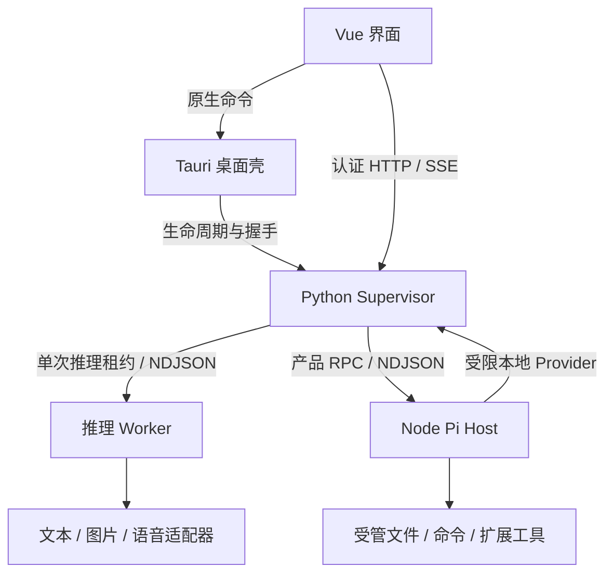

# 系统架构与不变量

[文档入口](./README.md) · [代码规范](./code-standards.md) · [子系统维护](./subsystems/README.md) · [验证范围](./verification.md)

本文定义 Ownloom 的长期系统边界。修改功能时必须保持这些约束；需要改变边界时，先用 [ADR](./adr/0001-runtime-boundaries.md) 说明原因、替代方案、迁移和验证。当前版本、限额、运行命令和验收结果分别归属子系统文档、[开发指南](./development.md)与验证记录，不在这里重复维护。

## 产品与信任边界

Ownloom 是面向 Apple Silicon macOS 的本地 AI 工作台。桌面界面统一组织模型、聊天、图片、语音与 Coding，推理能力通过本地 Runtime 提供。FakeEngine 用于可重复的协议与产品测试，不能代表真实模型质量或发行包可靠性。

本地推理不等于所有操作离线：模型下载、用户启用的网页检索、MCP 连接和获授权的 Coding 命令可以联网。每条外部连接都应有明确的入口、凭据和权限边界，不能由项目内容、Skill 正文或模型输出扩大授权。

## 进程边界

| 边界              | 唯一职责                                                         | 不应承担的职责                               |
| ----------------- | ---------------------------------------------------------------- | -------------------------------------------- |
| Vue 界面          | 交互状态、工作区组合、事件投影与媒体展示                         | 直接访问数据库、调用模型库或自行启动任意进程 |
| Tauri 桌面壳      | 固定 Runtime 生命周期、原生对话框、受控导出与系统集成            | 聊天、任务调度、模型业务和 Coding 历史       |
| Python Supervisor | 产品 HTTP/SSE、模型目录、推理调度、普通聊天、媒体与 Runtime 数据 | 驻留大型模型、直接打开 Node 数据库           |
| 推理 Worker       | 模型加载、输入适配、生成、进度、取消与释放                       | 产品会话管理、UI 状态、跨任务授权            |
| Node Pi Host      | Coding/Agent 编排、扩展管理、审批与本方持久化                    | 第二套模型推理服务、普通聊天数据库写入       |

具体装配入口为 [桌面 composition root](../apps/desktop/src/app/composition-root.ts)、[RuntimeApplication](../services/runtime/src/mlx_studio_runtime/composition_root.py) 和 [createCodingService](../services/coding-agent/src/composition-root.ts)。Tauri 入口见 [run](../apps/desktop/src-tauri/src/lib.rs)。

## 依赖与状态所有权

业务状态转移、校验、预算和策略尽量表达为纯函数。Application 依赖窄端口，具体 Repository、文件、模型和系统实现由组合根注入。Domain 不引入 UI、HTTP、数据库或模型框架；具体语言约束由代码规范维护。

每种状态只有一个权威所有者，其他模块使用只读投影或显式接口：

| 状态                           | 所有者                             | 消费方式                       |
| ------------------------------ | ---------------------------------- | ------------------------------ |
| 桌面 Runtime 连接与代际        | 桌面平台连接边界                   | 工作区订阅连接快照             |
| 模型目录、驻留模型与 Worker    | Runtime 的目录服务与 ModelRuntime  | 工作区查询目录；调度器取得租约 |
| 推理 Job 与唯一终态            | JobScheduler / JobLifecycle        | API 快照与 Runtime 事件        |
| 普通聊天、下载、附件和媒体记录 | Runtime Repository                 | 认证用例接口                   |
| Coding/Agent 产品记录          | Node Repository                    | 产品 RPC 与持久化事件          |
| Coding/Agent 模型上下文        | Pi SessionManager 的 transcript    | 经描述符验证后恢复             |
| Skill/MCP 配置与版本           | Node 扩展仓库                      | 不可变运行快照                 |
| 外部服务秘密                   | Python SecretStore / 系统 Keychain | 版本绑定的秘密引用             |

任务中心组合各所有者返回的摘要，不跨进程读取对方数据库。普通聊天 Conversation、CodingRun、AgentRun 和推理 Job 具有不同身份，不能为了复用界面而合并持久化模型。

## 资源与生命周期不变量

1. **最多一个大型模型推理租约。** 文本、视觉、图片、语音与 Agent 内部推理共用调度器。父 AgentRun 不长期持有推理锁，等待工具、审批、网络或文件 I/O 时应释放模型执行租约。
2. **Worker 只有一个生命周期所有者。** ModelRuntime 持有实例与加载状态，RuntimeControl 通过调度器协调显式控制。业务服务不能自行停止其他任务的 Worker。
3. **取消优先且最终收敛。** 已接纳取消的任务不能被迟到成功覆盖；取消、重复请求和重复终态必须保持幂等。释放资源失败时关闭新接纳，进入可见故障状态。
4. **页面生命周期不等于任务生命周期。** 切页释放观察者、轮询、下载句柄和 Object URL；后台任务只有通过明确取消或生命周期恢复规则才终止。
5. **晚到结果必须有归属。** 连接、Worker、任务尝试、媒体读取与工作区查询使用各自代际或版本，旧结果不能写入新的会话与实例。
6. **重启恢复记录，不自动重放副作用。** 未完成任务收敛为中断或失败，旧审批与运行凭据失效。历史保留不代表模型断点续算或命令可安全重跑。

当前实现与错误路径见 [Runtime](./subsystems/runtime.md)、[Coding](./subsystems/coding.md)和[扩展](./subsystems/extensions.md)。

## 协议与事件不变量

产品 HTTP 契约、Host RPC 和 Worker 协议是三个独立边界，不能把版本号或消息类型混用。

| 契约                    | 权威来源                                                                                                  | 维护方式                          |
| ----------------------- | --------------------------------------------------------------------------------------------------------- | --------------------------------- |
| 产品 HTTP / OpenAPI     | [FastAPI 路由与 DTO](../services/runtime/src/mlx_studio_runtime/entrypoints/http)                         | 生成前端 API 类型；入口做协议适配 |
| Python ↔ Node 产品 RPC | [coding-protocol/schema.json](../packages/coding-protocol/schema.json)                                    | 同源生成两端类型与校验数据        |
| Supervisor ↔ Worker    | [worker_protocol.py](../services/runtime/src/mlx_studio_runtime/domain/worker_protocol.py) 与 Worker Host | 显式握手、帧限额、任务与尝试关联  |

进程 stdout 只输出协议帧，诊断走单独通道。未知版本、非法消息、越界结果和不完整结构化工具调用必须明确失败，不能悄悄转为普通提示词或成功结果。

事件负责同步视图，持久化记录负责恢复业务事实。Runtime 的事件缓冲只覆盖当前实例，缺口通过快照恢复；Node 的产品事件与状态同事务写入，游标可跨 Host 重启使用。通知成功不能替代数据库提交成功。

## 一致性、身份与恢复

接纳编号绑定完整意图：相同编号、相同输入返回原结果；相同编号、不同输入返回冲突。接纳用户消息与任务、保存结果与任务终态分别属于明确的用例事务。先提交，再发布对应成功事件。

数据库、文件、Pi JSONL 和外部工具之间没有分布式事务。媒体使用暂存、补偿与启动恢复；受管编辑保留前后内容及摘要；工具执行结果未知时保留不确定性，不能承诺 exactly once。

模型登记身份与权重内容身份分离。扫描、下载完成和目录名称不能证明模型兼容；只有明确的 Manifest、静态配置和对应适配器决定候选能力。物理删除需要托管所有权及全部活动引用检查，导入用户目录不自动取得删除权。

备份由各数据所有者导出一致快照与清单。恢复先校验路径、大小、摘要和 transcript，再导入独立 profile；全部所有者完成后才切换指针，保留原资料库。详情见[存储与恢复](./subsystems/storage.md)。

## 安全与可观测性

Runtime 仅绑定回环地址，桌面会话 Token 不进入持久化数据或公开握手。内部推理、扩展能力及可选外部 API 使用各自授权边界，不能把桌面 Token 交给 Coding 命令或 MCP 进程。

模型扫描不执行远程模型代码。受管文件校验规范路径、符号链接、内容摘要和大小；秘密与公开配置分离。模型输出、项目说明和外部服务返回值都不能修改应用权限策略。

Coding 与 MCP 的命令审批属于应用权限控制，不提供操作系统级沙箱。文档必须明确本机用户权限、网络访问和受管工具限制的实际范围，不能把“只读工具”推广为任意命令的系统隔离保证。

诊断优先记录操作、请求/任务标识、耗时、阶段和稳定错误码，避免默认输出完整提示词、响应、文件内容或秘密。错误、取消、空结果、部分证据与服务不可用应有不同的产品表达。

## 修改架构时的维护要求

每次跨边界修改至少确认：状态所有者是否改变、协议是否同步生成、取消和恢复如何收敛、文件与数据库补偿是否完整、用户权限是否扩大、相关文档和回归是否更新。

基础设施检查、FakeEngine、真实模型、包内运行、签名、公证和干净机器是不同层次的证据。通过某一层不能代替其他层；执行方法和已知缺口统一见[验证范围](./verification.md)与[发布验收](./release-acceptance.md)。
