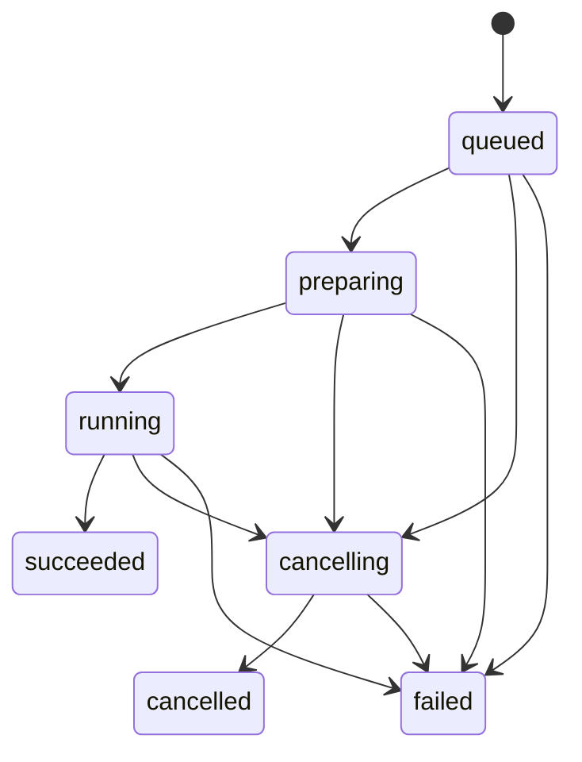

# Runtime、推理 Worker 与任务调度

[子系统索引](./README.md) · [系统架构](../architecture.md) · [开发指南](../development.md) · [验证范围](../verification.md)

## 职责与边界

Python Supervisor 提供认证 HTTP/SSE、产品用例、模型目录、任务调度与本地存储。大型模型由独立 Worker 加载；Node Pi Host 通过受限本地 Provider 复用同一推理调度器。Rust 只管理固定 Supervisor 的生命周期，Node 不直接调用 MLX。

本页维护启动、协议、调度和故障排查路径。模型识别见[模型管理](./models.md)，聊天准备见[聊天](./chat.md)，持久化与恢复见[存储](./storage.md)。长期约束以系统架构为准。

## 事实来源

| 主题                 | 代码入口与关键符号                                                                                                                                                                                                                                                                                     |
| -------------------- | ------------------------------------------------------------------------------------------------------------------------------------------------------------------------------------------------------------------------------------------------------------------------------------------------------ |
| 依赖装配             | [composition_root.py](../../services/runtime/src/mlx_studio_runtime/composition_root.py)：`RuntimeApplication`                                                                                                                                                                                         |
| 进程入口与握手       | [http/main.py](../../services/runtime/src/mlx_studio_runtime/entrypoints/http/main.py)：`serve`、`main`                                                                                                                                                                                                |
| HTTP 认证与路由      | [http/app.py](../../services/runtime/src/mlx_studio_runtime/entrypoints/http/app.py)：`create_app`、`_register_openai_api`                                                                                                                                                                             |
| 任务状态机           | [domain/jobs.py](../../services/runtime/src/mlx_studio_runtime/domain/jobs.py)：`JobState`、`transition_job`                                                                                                                                                                                           |
| 租约、取消与排队     | [job_scheduler.py](../../services/runtime/src/mlx_studio_runtime/application/job_scheduler.py)：`JobScheduler`                                                                                                                                                                                         |
| 事务与终态           | [job_lifecycle.py](../../services/runtime/src/mlx_studio_runtime/application/job_lifecycle.py)：`JobLifecycle.finish`                                                                                                                                                                                  |
| 模型生命周期         | [model_runtime.py](../../services/runtime/src/mlx_studio_runtime/application/model_runtime.py)：`ModelRuntime`；[runtime_control.py](../../services/runtime/src/mlx_studio_runtime/application/runtime_control.py)：`RuntimeControl`                                                                   |
| Worker 传输与 Driver | [worker_host.py](../../services/runtime/src/mlx_studio_runtime/adapters/worker_host.py)、[worker_runtime/runtime.py](../../services/runtime/src/mlx_studio_runtime/adapters/worker_runtime/runtime.py)、[drivers.py](../../services/runtime/src/mlx_studio_runtime/adapters/worker_runtime/drivers.py) |
| 结构化推理           | [inference_service.py](../../services/runtime/src/mlx_studio_runtime/application/inference_service.py)：`InferenceService`                                                                                                                                                                             |
| 事件缓冲             | [event_hub.py](../../services/runtime/src/mlx_studio_runtime/adapters/event_hub.py)：`EventHub`                                                                                                                                                                                                        |
| 桌面进程控制         | [supervisor.rs](../../apps/desktop/src-tauri/src/runtime/supervisor.rs)、[handshake.rs](../../apps/desktop/src-tauri/src/runtime/handshake.rs)                                                                                                                                                         |

## 启动与连接

Tauri 启动时创建会话 Token、确定应用数据目录，启动固定开发入口或包内 Sidecar。Supervisor 绑定 `127.0.0.1` 的随机端口，在服务就绪后向 stdout 输出 `runtime.ready` 帧，包含端口、PID 和 `protocol_version`，不包含 Token。

桌面壳校验握手并保存连接代际。前端通过原生命令取得连接信息，再访问 `/internal/v1`。重启后旧代际的连接与失败回调都不能覆盖新实例；连接故障不应让界面继续使用旧 Token。

入口支持 `--worker`、`--download`、`--prepare` 子进程模式，避免冻结应用的辅助进程误入 HTTP 入口。`multiprocessing.freeze_support()` 与父进程管道监听用于打包环境；启用父管道监听后，EOF 触发 Supervisor 清理。

默认数据目录和环境变量的准确值见[参考配置](../reference.md)。开发与发行入口不同，修改启动参数时应同时核对 Rust Supervisor、Sidecar 构建脚本和包内验收。

## 一次推理的运行路径

1. HTTP 入口校验协议与认证，Application 校验模型、能力、输入和接纳条件。
2. 用例保存任务与必要业务输入；重复提交通过持久化编号回到原任务。
3. JobScheduler 分配执行租约。聊天使用 `schedule_prepared`，在锁外准备附件和网页资料，再等待模型租约。
4. ModelRuntime 确认模型，必要时停止旧 Worker 并加载新模型。加载中的模型和 Worker 先登记归属，便于取消回收。
5. Worker Driver 适配输入、生成增量或媒体、回传最终结果。只有当前任务及尝试的事件有效。
6. 用例验证结果并提交最终业务记录和任务终态；提交成功后发布对应事件。聊天的准备/最终提交不应停止其他任务正在使用的 Worker。

内部结构化推理将 `generation.result` 暂存，必须再收到完成事件并成功落盘才向调用者返回成功。EOF、非法工具参数、重复终态、取消或落盘错误都不能产生成功 finish。

本地 Provider 的非上下文溢出错误消息保留 `[runtime:错误码]` 标记，兼容 Pi/OpenAI SDK 在 SSE 错误中只保留 `message` 的行为；结构化 `code` 字段继续存在。上下文溢出保留 SDK 识别所需的原格式。Host 仅提取稳定错误码，界面使用已有中文错误映射，不将任意 Provider 响应正文作为错误原因保存。

本地结构化接口的 `max_tokens` 不再有固定 8192 上限，显式值仍须通过模型窗口校验。`output_budget=remaining` 在 Worker 完成模板渲染与实际分词后使用剩余空间；可选 `context_limit` 只能收紧模型窗口。默认 `fixed` 保留既有显式/缺省行为，计算结果不改写调用方输入。Coding 的请求选择与 Pi 工具校验职责见 [Coding 参考](./coding.md#验证证据与当前限制)。

## 状态与失败收敛



终态不再转移。`JobLifecycle.finish` 在收到取消后把迟到完成收敛为取消，不执行成功持久化回调。进程启动时把尚未结束的任务恢复为带错误码的失败记录；用户可以复用输入重新发起任务，但不能从旧推理中间位置继续。

取消先通知当前 Worker，超过协作取消窗口后取消宿主任务并停止相应实例。`ModelRuntime` 记录当前 Worker 的资源释放失败；任务准入、排队任务取得租约及显式加载均检查这一状态，不能因模型 ID 相同而把故障 Worker 当作已加载。成功停止该 Worker 才能清除资源故障；调度器的 `poisoned` 仍用于关闭失败与重启期间的接纳，显式重启完成后再开放。加载失败但已成功回收 Worker 时允许改选模型或重试。`RuntimeControl.restart` 的中断路径不等待当前推理锁，否则卡住的推理可能阻塞自身恢复。

模型删除先预约同路径的登记与任务引用，再取得租约并卸载；不能边生成边删文件。具体所有权规则由模型子系统维护。

## 协议与恢复

当前 Runtime 握手版本以 [PROTOCOL_VERSION](../../services/runtime/src/mlx_studio_runtime/__init__.py) 为准；Host RPC 的独立版本见 [Coding](./coding.md)。Worker 协议使用命令 ID、Job ID、序列、实例代际和尝试标识，双方协商 UTF-8 帧及结果上限。

普通聊天的 `generation.start` 可附带应用层提供的 `conversation_id` 与 `cache_suffix`，用于隔离会话缓存及标记易变的输入尾部；缺省分别为 `None` 与空字符串，不改变握手版本。缓存属于文本 Worker 的引擎会话，生命周期及容量规则见[多轮前缀缓存](./chat.md#多轮前缀缓存)。`inference.start` 在结构化推理前清空普通聊天缓存。MLX 编译仍由 `WorkerContext.configure_device` 关闭，前缀复用不会改变这项退出兼容策略。

| 限额                            | 当前实现       | 权威来源                                                                                      |
| ------------------------------- | -------------- | --------------------------------------------------------------------------------------------- |
| Worker 帧 / 最终结果            | 各 16 MiB      | [worker_protocol.py](../../services/runtime/src/mlx_studio_runtime/domain/worker_protocol.py) |
| 单段增量 / 工具参数             | 64 KiB / 2 MiB | 同上                                                                                          |
| Worker 流式队列                 | 32 项          | 同上                                                                                          |
| Runtime 历史事件缓冲 / 订阅队列 | 1024 / 512 项  | [EventHub](../../services/runtime/src/mlx_studio_runtime/adapters/event_hub.py)               |

Runtime 事件缓冲存在内存中，实例重启后不承诺继续回放旧游标。游标过旧、超过当前序列或订阅者溢出时发送 `runtime.resync_required`，消费者从持久化任务和会话快照恢复。Node 事件具有独立的持久化游标，不应复用 Runtime 事件序号。

## 实验性草稿接入

[草稿所有者](../../services/runtime/src/mlx_studio_runtime/adapters/text_engines/drafts.py)属于 EngineSession，在现有 Python/MLX/MLX-VLM 环境中绑定模型库的[草稿设置](./models.md#实验性草稿加速)。主模型只加载一次，自动模式同时持有 MTP 与 DFlash2 头，每个请求选择一个。目标和全部所需草稿成功加载、绑定、求值后才发布已加载；失败返回 `DRAFT_LOAD_FAILED` 并释放 Worker，不静默回退。关闭和图片请求沿普通生成路径，不改变编译关闭策略。

[MTP](../../services/runtime/src/mlx_studio_runtime/adapters/text_engines/mtp.py)使用 MLX-VLM 0.6.14 的原生接口。[DFlash2](../../services/runtime/src/mlx_studio_runtime/adapters/text_engines/dflash2/bridge.py)接入同一 VLM 的采样、投机验证、混合 GDN 缓存回滚和流式解码。网络、动态卷积及 candidate selector 从 `z-lab/dflash` 的固定提交 `07ebd93db9f472af339b644bb70221ad8428328a` 适配，保留 [MIT 许可证](../../services/runtime/src/mlx_studio_runtime/adapters/text_engines/dflash2/LICENSE)；仅保留本地网络加载，不引入其独立服务、运行时补丁或依赖版本约束。全部张量严格加载后，在内存中做 4bit/group64 量化，再绑定目标共享权重。

普通聊天保留 MTP 的会话隔离 APC；结构化推理仍先清理聊天缓存，Coding 使用下述独立前缀缓存。显式选择 DFlash2 普通聊天时关闭 APC，该聊天路径尚未保存草稿特征。DFlash2 预填充分块上限为 512 token，仅保留草稿滑动窗口所需特征，临时层包装关闭预填充回滚历史收集；开始投机验证前恢复原始目标层。没有修改上游类或虚拟环境文件。完成、异常、构造流失败和取消都关闭原生流，再清理请求特征；卸载先释放两套草稿对目标的引用。

调用方温度、输出预算、模板、工具解析不变。两种草稿在温度大于 0 时都传入随机种子，但锁定的 MLX-VLM 0.6.14 中两条路径的采样方式不同：MTP 的目标验证采用按生成位置派生的随机 key，避免旧路径重新赋值 MLX 0.32.1 的只读 `random.state`；DFlash2 仅首个目标 token 走按位置采样，后续验证块通过 sampler 的普通调用使用全局 RNG，不能将该随机种子解释为整轮可重现保证。DFlash2 的候选提议固定为贪心，输出仍由目标按用户温度采样并逐段验证，草稿提议不直接作为回复。该调用差异本身不证明随机分布错误；当前证据也未证明逐 token 等价、随机分布等价、跨任务质量不变或稳定倍速。

## Coding 多轮前缀缓存

[CodingPrefixCache](../../services/runtime/src/mlx_studio_runtime/adapters/text_engines/coding_cache.py)属于文本 EngineSession，只保留当前 Coding 会话的一份内存快照，不写磁盘。[CapabilityGrants](../../services/runtime/src/mlx_studio_runtime/application/capability_grants.py)从已授权运行的 `sessionId` 派生内部 `cache_scope`；同会话不同运行共享范围，客户端请求体不能指定它。Agent Chat、未带范围的能力探针和普通 Provider 请求不启用该缓存。

[预填充适配器](../../services/runtime/src/mlx_studio_runtime/adapters/text_engines/coding_prefill.py)仅接纳配置为 `qwen3_5` 且上游明确支持 exact APC 的纯文字结构化推理。MTP、DFlash2 和关闭草稿均可使用；其他模型保持完整输入路径。命中必须同时满足会话、已加载模型、草稿方案、模板、工具 Schema 和完整 token 前缀匹配。历史编辑、压缩或更换提示导致前缀不匹配时重新处理输入，不裁剪或拼接混合模型的循环状态。

每轮在输入末尾 16 token 之前保存完整 KV/GDN 状态，后续只计算快照后的输入，并将检查点推进到本轮边界。检查点在生成之前建立，生成和投机验证只修改独立工作副本，不将未经验证的草稿后缀存入快照。DFlash2 同步保存各目标层滑动窗口特征和绝对 token 位置；恢复后追加新输入特征，随后仍由目标模型验证草稿。特征和主模型状态必须位于同一前缀边界。

输入上限 32,768 token，单快照中所有层与草稿特征合计最多 2 GiB，超过上限或无法计量时不保留快照。这不是整个模型推理的内存上限。切换会话或缓存身份、普通聊天、无工具摘要/压缩、模型卸载、Worker 重启及推理取消/失败会清理相应快照。缓存查找失败记录异常类型并回退完整输入；保存失败释放保留快照，当前请求仍可继续使用已经计算的有效工作副本，不重放输入或工具调用。正在执行的预填充分块检查取消信号。

结构化结果的 `cached_tokens` 表示真正从上一请求复用的输入数量，`prefix_cache` 保存当前检查点的 token 数和占用字节。Provider 在流式与非流式 usage 中通过 `prompt_tokens_details.cached_tokens` 返回命中量，Pi transcript 可记录 `cacheRead`；总输入仍包含已缓存 token，输出预算仍按完整上下文计算。缓存减少重复输入处理，不保证提高生成 token/s；本机实测与未覆盖范围见[验证记录](../verification.md#coding-多轮缓存实测)。

有有效原生统计的成功结构化结果同时携带可选 `generationStats`。Provider 在成功提交后的 usage-only 流式帧（`choices: []`）附加 `ownloom.generationStats`，非流式成功响应也提供同一扩展；失败或取消不发布成功统计。Host 通过 Pi 原生 `onProviderStreamEvent` 读取该扩展，每次 Provider 请求重置测量归属，只在成功 `assistant.message`（`stop` 或 `toolUse`）事件中保存并交给共享界面展示。没有通过 Pi usage、字符数、流式到达间隔或整个 Coding 运行耗时重算引擎 token/s。

附加耗时均以 Worker 本轮生成开始为起点：`firstTokenMs` 到首个可见非空文本，`prefillMs` 到首个原生 token，`durationMs` 到本轮生成结束。三者均排除队列等待、模型加载、联网准备和工具执行；`prefillMs` 包含模板、缓存处理、预填充及首 token 计算，因此界面称为“输入准备”。字段与兼容规则见[生成统计](./chat.md#生成统计)。

配置与当前启用的草稿文件版本纳入 Coding 工具能力身份。可用性、真实模型、HTTP/SSE 和发行包证据分开记录于[验证范围](../verification.md)。

## 安全与可观测性

内部业务接口要求临时 Bearer。OpenAPI 描述内部产品契约，不能据此宣称公开服务可用。可选 `/v1` 使用独立开关和 Token，当前 `/v1/chat/completions` 仍返回 `501`，不能在 README 中宣传为可用的完整 OpenAI 兼容服务。

stdout 专用于握手/NDJSON。默认诊断避免完整输入、输出和秘密；应保留稳定错误码、Job/请求标识、Worker 代际与阶段。系统内存和 Worker 当前占用是资源指标，不应标成独占显存或整个应用占用。

真实引擎依赖只在适配器/Worker 边界加载。FakeEngine 的成功证明协议与用例路径可运行，不证明上游 MLX API、模型权重、GPU 资源或发行环境通过验收。

发行 Sidecar 的 profile、依赖收集策略与离线 CPU 包内检查统一见[开发指南的 Runtime Sidecar 依赖边界](../development.md#runtime-sidecar-依赖边界)。依赖边界调整需覆盖动态引擎导入与运行资源，不能以源码测试代替冻结应用验证。

## 验证与维护

从仓库根目录执行，环境准备见开发指南：

```bash
pnpm check runtime
pnpm check boundaries
pnpm test runtime
pnpm generate api
git diff --exit-code -- packages/api-client/src/generated-schema.d.ts
```

生命周期重点回归：[任务与服务](../../tests/test_runtime_service.py)、[Worker 协议](../../tests/test_worker_protocol.py)、[加载取消](../../tests/test_load_cancellation.py)、[结构化推理故障](../../tests/test_inference_reliability.py)、[父进程退出](../../tests/test_parent_lifetime.py)。HTTP 契约变化同时更新生成类型；Worker 协议变化同时验证两端限额、分片和错误收敛。

Sidecar 构建、包内退出、真实模型与签名环境必须单独验证。结果及尚未验证项统一记录在[验证范围](../verification.md)，正式交付按[发布验收](../release-acceptance.md)执行。
