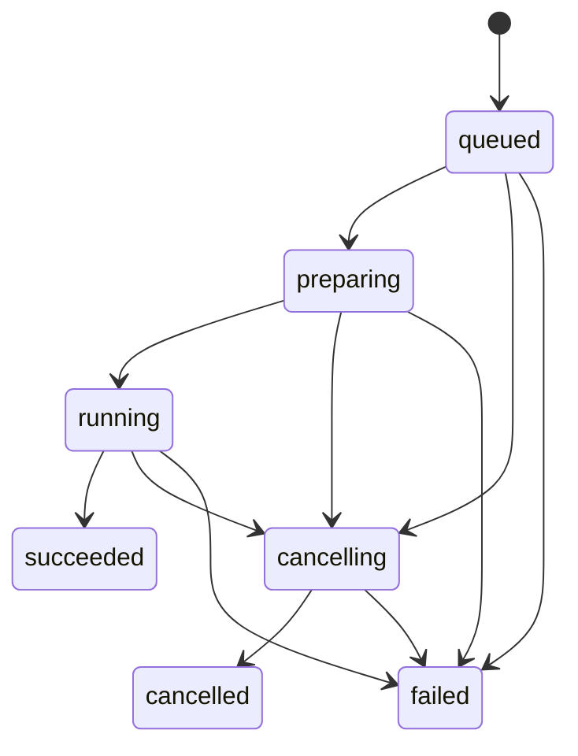

# Runtime、推理 Worker 与任务调度

[子系统索引](./README.md) · [系统架构](../architecture.md) · [开发指南](../development.md) · [验证范围](../verification.md)

## 职责与边界

Python Supervisor 提供认证 HTTP/SSE、产品用例、模型目录、任务调度与本地存储。大型模型由独立 Worker 加载；Node Pi Host 通过受限本地 Provider 复用同一推理调度器。Rust 只管理固定 Supervisor 的生命周期，Node 不直接调用 MLX。

本页维护启动、协议、调度和故障排查路径。模型识别见[模型管理](./models.md)，聊天准备见[聊天](./chat.md)，持久化与恢复见[存储](./storage.md)。长期约束以系统架构为准。

## 事实来源

| 主题                 | 代码入口与关键符号                                                                                                                                                                                                                                                                                     |
| -------------------- | ------------------------------------------------------------------------------------------------------------------------------------------------------------------------------------------------------------------------------------------------------------------------------------------------------ |
| 依赖装配             | [composition_root.py](../../services/runtime/src/mlx_studio_runtime/composition_root.py)：`RuntimeApplication`                                                                                                                                                                                         |
| 进程入口与握手       | [http/main.py](../../services/runtime/src/mlx_studio_runtime/entrypoints/http/main.py)：`serve`、`main`                                                                                                                                                                                                |
| HTTP 认证与路由      | [http/app.py](../../services/runtime/src/mlx_studio_runtime/entrypoints/http/app.py)：`create_app`、`_register_openai_api`                                                                                                                                                                             |
| 任务状态机           | [domain/jobs.py](../../services/runtime/src/mlx_studio_runtime/domain/jobs.py)：`JobState`、`transition_job`                                                                                                                                                                                           |
| 租约、取消与排队     | [job_scheduler.py](../../services/runtime/src/mlx_studio_runtime/application/job_scheduler.py)：`JobScheduler`                                                                                                                                                                                         |
| 事务与终态           | [job_lifecycle.py](../../services/runtime/src/mlx_studio_runtime/application/job_lifecycle.py)：`JobLifecycle.finish`                                                                                                                                                                                  |
| 模型生命周期         | [model_runtime.py](../../services/runtime/src/mlx_studio_runtime/application/model_runtime.py)：`ModelRuntime`；[runtime_control.py](../../services/runtime/src/mlx_studio_runtime/application/runtime_control.py)：`RuntimeControl`                                                                   |
| Worker 传输与 Driver | [worker_host.py](../../services/runtime/src/mlx_studio_runtime/adapters/worker_host.py)、[worker_runtime/runtime.py](../../services/runtime/src/mlx_studio_runtime/adapters/worker_runtime/runtime.py)、[drivers.py](../../services/runtime/src/mlx_studio_runtime/adapters/worker_runtime/drivers.py) |
| 结构化推理           | [inference_service.py](../../services/runtime/src/mlx_studio_runtime/application/inference_service.py)：`InferenceService`                                                                                                                                                                             |
| 事件缓冲             | [event_hub.py](../../services/runtime/src/mlx_studio_runtime/adapters/event_hub.py)：`EventHub`                                                                                                                                                                                                        |
| 桌面进程控制         | [supervisor.rs](../../apps/desktop/src-tauri/src/runtime/supervisor.rs)、[handshake.rs](../../apps/desktop/src-tauri/src/runtime/handshake.rs)                                                                                                                                                         |

## 启动与连接

Tauri 启动时创建会话 Token、确定应用数据目录，启动固定开发入口或包内 Sidecar。Supervisor 绑定 `127.0.0.1` 的随机端口，在服务就绪后向 stdout 输出 `runtime.ready` 帧，包含端口、PID 和 `protocol_version`，不包含 Token。

桌面壳校验握手并保存连接代际。前端通过原生命令取得连接信息，再访问 `/internal/v1`。重启后旧代际的连接与失败回调都不能覆盖新实例；连接故障不应让界面继续使用旧 Token。

入口支持 `--worker`、`--download`、`--prepare` 子进程模式，避免冻结应用的辅助进程误入 HTTP 入口。`multiprocessing.freeze_support()` 与父进程管道监听用于打包环境；启用父管道监听后，EOF 触发 Supervisor 清理。

默认数据目录和环境变量的准确值见[参考配置](../reference.md)。开发与发行入口不同，修改启动参数时应同时核对 Rust Supervisor、Sidecar 构建脚本和包内验收。

## 一次推理的运行路径

1. HTTP 入口校验协议与认证，Application 校验模型、能力、输入和接纳条件。
2. 用例保存任务与必要业务输入；重复提交通过持久化编号回到原任务。
3. JobScheduler 分配执行租约。聊天使用 `schedule_prepared`，在锁外准备附件和网页资料，再等待模型租约。
4. ModelRuntime 确认模型，必要时停止旧 Worker 并加载新模型。加载中的模型和 Worker 先登记归属，便于取消回收。
5. Worker Driver 适配输入、生成增量或媒体、回传最终结果。只有当前任务及尝试的事件有效。
6. 用例验证结果并提交最终业务记录和任务终态；提交成功后发布对应事件。聊天的准备/最终提交不应停止其他任务正在使用的 Worker。

内部结构化推理将 `generation.result` 暂存，必须再收到完成事件并成功落盘才向调用者返回成功。EOF、非法工具参数、重复终态、取消或落盘错误都不能产生成功 finish。

## 状态与失败收敛



终态不再转移。`JobLifecycle.finish` 在收到取消后把迟到完成收敛为取消，不执行成功持久化回调。进程启动时把尚未结束的任务恢复为带错误码的失败记录；用户可以复用输入重新发起任务，但不能从旧推理中间位置继续。

取消先通知当前 Worker，超过协作取消窗口后取消宿主任务并停止相应实例。关闭资源失败时，调度器保持 `poisoned`，拒绝新推理，直到显式恢复成功。`RuntimeControl.restart` 的中断路径不等待当前推理锁，否则卡住的推理可能阻塞自身恢复。

模型删除先预约同路径的登记与任务引用，再取得租约并卸载；不能边生成边删文件。具体所有权规则由模型子系统维护。

## 协议与恢复

当前 Runtime 握手版本以 [PROTOCOL_VERSION](../../services/runtime/src/mlx_studio_runtime/__init__.py) 为准；Host RPC 的独立版本见 [Coding](./coding.md)。Worker 协议使用命令 ID、Job ID、序列、实例代际和尝试标识，双方协商 UTF-8 帧及结果上限。

| 限额                            | 当前实现       | 权威来源                                                                                      |
| ------------------------------- | -------------- | --------------------------------------------------------------------------------------------- |
| Worker 帧 / 最终结果            | 各 16 MiB      | [worker_protocol.py](../../services/runtime/src/mlx_studio_runtime/domain/worker_protocol.py) |
| 单段增量 / 工具参数             | 64 KiB / 2 MiB | 同上                                                                                          |
| Worker 流式队列                 | 32 项          | 同上                                                                                          |
| Runtime 历史事件缓冲 / 订阅队列 | 1024 / 512 项  | [EventHub](../../services/runtime/src/mlx_studio_runtime/adapters/event_hub.py)               |

Runtime 事件缓冲存在内存中，实例重启后不承诺继续回放旧游标。游标过旧、超过当前序列或订阅者溢出时发送 `runtime.resync_required`，消费者从持久化任务和会话快照恢复。Node 事件具有独立的持久化游标，不应复用 Runtime 事件序号。

## 安全与可观测性

内部业务接口要求临时 Bearer。OpenAPI 描述内部产品契约，不能据此宣称公开服务可用。可选 `/v1` 使用独立开关和 Token，当前 `/v1/chat/completions` 仍返回 `501`，不能在 README 中宣传为可用的完整 OpenAI 兼容服务。

stdout 专用于握手/NDJSON。默认诊断避免完整输入、输出和秘密；应保留稳定错误码、Job/请求标识、Worker 代际与阶段。系统内存和 Worker 当前占用是资源指标，不应标成独占显存或整个应用占用。

真实引擎依赖只在适配器/Worker 边界加载。FakeEngine 的成功证明协议与用例路径可运行，不证明上游 MLX API、模型权重、GPU 资源或发行环境通过验收。

## 验证与维护

从仓库根目录执行，环境准备见开发指南：

```bash
pnpm check:runtime
pnpm check:boundaries
pnpm test:runtime
pnpm api:generate
git diff --exit-code -- packages/api-client/src/generated-schema.d.ts
```

生命周期重点回归：[任务与服务](../../tests/test_runtime_service.py)、[Worker 协议](../../tests/test_worker_protocol.py)、[加载取消](../../tests/test_load_cancellation.py)、[结构化推理故障](../../tests/test_inference_reliability.py)、[父进程退出](../../tests/test_parent_lifetime.py)。HTTP 契约变化同时更新生成类型；Worker 协议变化同时验证两端限额、分片和错误收敛。

Sidecar 构建、包内退出、真实模型与签名环境必须单独验证。结果及尚未验证项统一记录在[验证范围](../verification.md)，正式交付按[发布验收](../release-acceptance.md)执行。
