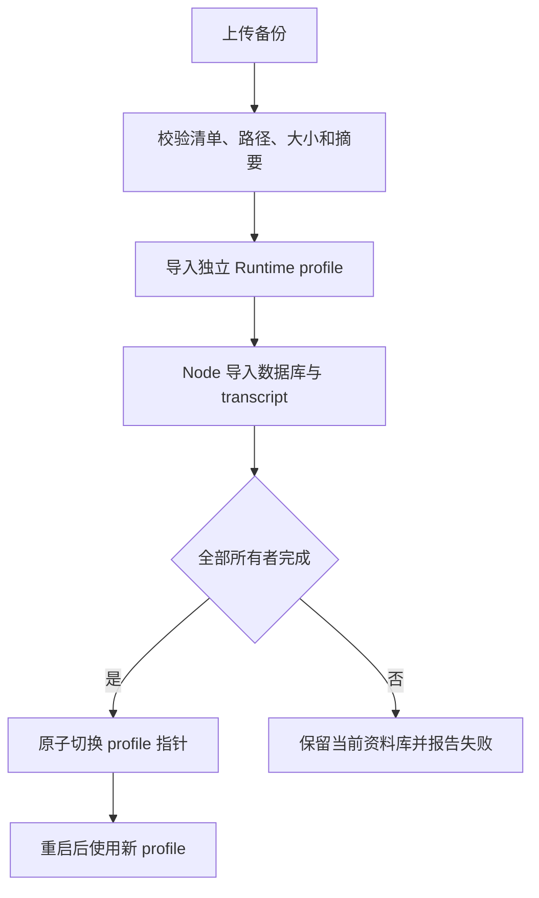

# 数据所有权、备份与恢复

[子系统索引](./README.md) · [系统架构](../architecture.md) · [参考配置](../reference.md) · [验证范围](../verification.md)

## 职责与边界

Ownloom 使用 SQLite 保存可查询产品记录，媒体和模型上下文使用独立文件。Python 与 Node 分别管理自己的数据库，跨所有者操作通过用例接口协调。备份、删除和恢复都必须保留所有权与引用关系，不能通过直接打开另一进程的数据库绕过边界。

本页维护存储路径语义、事务边界、清理保护、导出和 profile 恢复。准确的默认根目录与环境变量见参考配置；模型权重管理见[模型子系统](./models.md)。

## 事实来源

| 主题                  | 代码入口与关键符号                                                                                                                                                                                                                                                                   |
| --------------------- | ------------------------------------------------------------------------------------------------------------------------------------------------------------------------------------------------------------------------------------------------------------------------------------ |
| Runtime 数据库与事务  | [sqlite_database.py](../../services/runtime/src/mlx_studio_runtime/adapters/persistence/sqlite_database.py)：`SQLiteDatabase`；[sqlite_repositories.py](../../services/runtime/src/mlx_studio_runtime/adapters/persistence/sqlite_repositories.py)                                   |
| 不可变消息版本        | [context_revisions.py](../../services/runtime/src/mlx_studio_runtime/adapters/persistence/context_revisions.py)、[conversation_repository.py](../../services/runtime/src/mlx_studio_runtime/adapters/persistence/conversation_repository.py)                                         |
| 附件引用与准备迁移    | [attachment_reference_repository.py](../../services/runtime/src/mlx_studio_runtime/adapters/persistence/attachment_reference_repository.py)、[attachment_context_migrations.py](../../services/runtime/src/mlx_studio_runtime/adapters/persistence/attachment_context_migrations.py) |
| 媒体恢复与清理        | [media_recovery.py](../../services/runtime/src/mlx_studio_runtime/adapters/media_recovery.py)、[storage_management.py](../../services/runtime/src/mlx_studio_runtime/adapters/storage_management.py)                                                                                 |
| 导出屏障与任务投影    | [data_management.py](../../services/runtime/src/mlx_studio_runtime/application/data_management.py)：`DataManagement`                                                                                                                                                                 |
| Python 备份与 profile | [backup_bundle.py](../../services/runtime/src/mlx_studio_runtime/adapters/backup_bundle.py)、[data_profiles.py](../../services/runtime/src/mlx_studio_runtime/adapters/data_profiles.py)：`DataProfiles`                                                                             |
| Node 数据与迁移       | [repository.ts](../../services/coding-agent/src/adapters/repository.ts)、[coding-migrations.ts](../../services/coding-agent/src/adapters/coding-migrations.ts)、[extensions/repository.ts](../../services/coding-agent/src/adapters/extensions/repository.ts)                        |
| Node 导出与恢复       | [data-export.ts](../../services/coding-agent/src/adapters/data-export.ts)、[data-restore.ts](../../services/coding-agent/src/adapters/data-restore.ts)、[transcript.ts](../../services/coding-agent/src/adapters/transcript.ts)                                                      |
| 原生备份导出          | [backup.rs](../../apps/desktop/src-tauri/src/commands/backup.rs)：`export_backup`                                                                                                                                                                                                    |

## 数据布局与所有者

下表相对 Runtime 数据库所在目录描述数据库路径；媒体根通过 `SQLiteDatabase.media_path` 推导。当数据库位于名为 `data` 的目录时，媒体使用其上一级的 `media`。

| 数据                                                        | 位置 / 表达                                      | 所有者                 |
| ----------------------------------------------------------- | ------------------------------------------------ | ---------------------- |
| 普通聊天、模型登记、Job、下载、附件引用、作品索引、授权账本 | `app.db`                                         | Python Runtime         |
| 媒体原件、派生内容、生成图片和音频                          | 推导出的 `media/`                                | 对应 Python 文件适配器 |
| Coding 项目、会话、Run、审批、变更与事件                    | `coding/coding.db`                               | Node Repository        |
| 独立 Agent Chat 产品记录                                    | `coding/agent-chat/agent-chat.db`                | Node Repository        |
| Skill/MCP 元数据、版本、绑定与撤销                          | `coding/extensions.db`                           | Node 扩展仓库          |
| Skill 内容                                                  | `coding/skills/<id>/<contentRevision>/`          | Node 受管文件适配器    |
| 模型上下文                                                  | Pi SessionManager 创建的 JSONL，由会话描述符引用 | Pi / Node              |
| 服务秘密                                                    | macOS Keychain                                   | Python SecretStore     |

不要根据应用展示名称推导磁盘位置、Keychain 命名空间或 Python 包名；这些都是已持久化的接口标识，应以配置与实现为准。

## 事务、引用与迁移

Runtime 使用 WAL 与外键，Application 用例将相互依赖的记录放入同一事务。提交消息与 Job、保存推理结果与终态不能拆成先后独立成功；事务提交后才更新内存投影并发出对应成功事件。

Node 的产品状态与事件同事务写入；事件序列持久化。Pi JSONL、项目文件和 SQLite 不共享事务，必须在恢复时核对 transcript 描述符、完整行、会话身份与父链，不能凭数据库中的路径存在就继续执行。

普通聊天资料使用不可变消息版本和冻结快照。重新生成让旧回答退出当前视图，不应破坏仍被排队任务或消息转换引用的正文。跨工作区引用使用明确来源标识和保护记录，清理前再次确认全部所有者。

Runtime 的 schema 迁移分布在明确的持久化适配器中；Node Coding 使用 `PRAGMA user_version`，扩展有独立结构。新增迁移需说明旧数据读取、失败恢复与重复运行行为，不能把一套数据库的版本号套用到另一套数据库。

附件上传的稳定编号仅在 hash、大小、类型和标准化文件名均相同时复用；失败只补偿本次操作拥有的文件，见[附件文件适配器](../../services/runtime/src/mlx_studio_runtime/adapters/attachment_files.py)与[附件仓库](../../services/runtime/src/mlx_studio_runtime/adapters/persistence/attachment_repository.py)。

草稿更新提交全量选择集合及独立 revision；同 revision 不同集合返回冲突，已关闭草稿不能被迟到上传或旧更新复活。该并发契约由[附件引用仓库](../../services/runtime/src/mlx_studio_runtime/adapters/persistence/attachment_reference_repository.py)维护。

结构迁移完成和历史引用回填完成分别标记；回填扫描全部历史任务与作品，缺失或损坏记录保留诊断。[引用回填](../../services/runtime/src/mlx_studio_runtime/adapters/persistence/attachment_reference_backfill.py)未完成时，[AttachmentGC](../../services/runtime/src/mlx_studio_runtime/adapters/attachment_gc.py)拒绝取得回收资格。

文件保存与数据库提交采用暂存、补偿和启动核对。启动恢复对孤立受管媒体使用 `.recovery` 等隔离路径；这不授予删除用户导入目录的权限。自动清理保持关闭，用户发起清理也需重新检查引用和活动任务。

## 备份运行路径

1. `DataManagement.backup` 检查推理、下载和附件准备没有活动任务，关闭 HTTP 写入接纳，等已接纳请求全部结束后再次检查后台任务；新写入返回 `BACKUP_IN_PROGRESS`，排空超过 30 秒返回 `BACKUP_BUSY`。
2. Node 同样先关闭写入接纳并排空已接纳的异步修改，再检查 Coding、Agent 和 MCP 测试没有后台工作，导出本方数据库快照，并验证和导出 Pi JSONL 前缀及受管 Skill 文件。查询与事件长轮询不持有写入租约。
3. Python 导出自己的 SQLite 快照，收集媒体与 Node 提供的导出目录，生成逐文件大小与 SHA-256 清单。
4. 生成 ZIP，并通过固定 Runtime 地址流式传给原生保存对话框；浏览器开发路径使用浏览器下载。

备份不包含模型权重、用户 Coding 项目工作区或 Keychain 明文凭据。它会包含聊天、transcript、受管变更记录和媒体，因此应作为用户私有数据处理，不能上传为公开问题附件。

Node 仍是 Node 数据库的唯一导出者，Python 只打包其导出文件。跨所有者快照屏障不意味着任意外部程序对磁盘的修改都受控制；导入仍必须完整验证清单和内容。

屏障由每次独占操作持有，失败、超时或取消都会释放；并发导出被拒绝的请求不能提前解开另一次操作的屏障。恢复激活也使用同一接纳协议。

## 恢复运行路径



`DataProfiles.validate` 拒绝重复条目、路径穿越、绝对路径、符号链接、未知布局、大小或摘要不符的归档，并检查 Runtime SQLite。正式导入前再次校验，避免预览之后文件变化。

Node 单独验证本方清单和数据库，重映射 transcript 路径并验证上下文身份；全部完成才写入 `restore-complete`。Python 随后以临时文件替换 `active-profile.json`，重启后生效。旧 profile 保留，回滚只切换指针，不自动重放任务或工具。

导入失败不应切换现用资料库。不完整导入可以重新准备；已完成的同一恢复标识可以幂等激活。外部模型目录、Coding 项目路径和服务凭据可能需要用户重新连接。

## 限制、安全与故障处理

| 边界                      | 当前实现                | 来源                                                                                        |
| ------------------------- | ----------------------- | ------------------------------------------------------------------------------------------- |
| ZIP 压缩 / 展开大小       | 4 GiB / 20 GiB          | [data_profiles.py](../../services/runtime/src/mlx_studio_runtime/adapters/data_profiles.py) |
| 归档条目 / 顶层清单       | 最多 200,000 条 / 4 MiB | 同上                                                                                        |
| 单个 Pi transcript / 单行 | 256 MiB / 4 MiB         | [transcript.ts](../../services/coding-agent/src/adapters/transcript.ts)                     |

模型权重下载、普通媒体导出和备份导出采用不同大小与流式策略，不应互换 IPC 路径。备份 ZIP 未提供应用层加密；保存位置和共享应由用户明确控制。

删除会话、清理媒体、撤销项目编辑和恢复 profile 是不同操作。删除 Coding 会话不删除项目与 Pi JSONL；移除模型登记不等于物理删除；媒体回收不应越过其他所有者的引用保护。

## 验证命令与维护

```bash
pnpm build coding
pnpm test coding
pnpm test runtime
pnpm test acceptance
```

在仓库根目录执行。重点回归：[data recovery](../../tests/test_data_recovery.py)、[history revisions](../../tests/test_history_revisions.py)、[附件迁移](../../tests/test_attachment_context_migrations.py)、[附件 GC](../../tests/test_attachment_gc.py)、[Node reliability](../../services/coding-agent/tests/reliability.test.mjs)和[验收脚本](../../scripts/acceptance/acceptance.spec.mjs)。

修改格式或恢复路径时，至少验证损坏 ZIP、缺失所有者、摘要不符、路径穿越、重启、重复恢复和回滚。包内实际数据恢复使用 [verify-packaged-data.mjs](../../scripts/acceptance/verify-packaged-data.mjs)，结果统一记录在[验证范围](../verification.md)，真实用户数据不得作为自动化 fixture。
